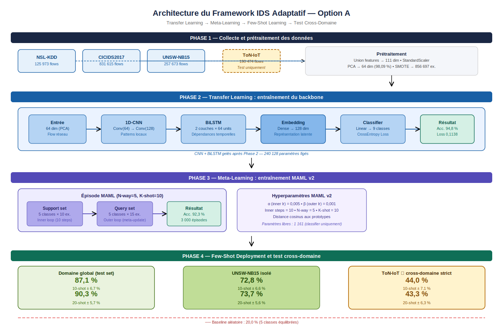

# Systèmes de défense adaptatifs contre les cyberattaques évolutives

Framework de détection d'intrusions réseau (IDS) combinant **Transfer Learning**, **Meta-Learning (MAML)** et **Few-Shot Learning (Prototypical Networks)**, avec une évaluation de la généralisation cross-domaine vers un environnement IoT jamais vu à l'entraînement.

Projet réalisé dans le cadre du **MSc Manager de la Cybersécurité — ECE Paris (2025-2026)**.
Auteure : Joyce Maeva Lengue Mbangue · Encadrante : Dr Roumaissa Bekkouche



## Question de recherche

Comment concevoir un framework de détection d'intrusions capable de s'adapter à un nouvel environnement réseau avec une dizaine d'exemples étiquetés, sans réentraînement complet ?

## Méthodologie (configuration « Option A »)

| Phase | Description |
|---|---|
| 1. Données | Fusion de NSL-KDD, CICIDS2017 et UNSW-NB15 (1 215 261 flux, 9 super-classes). Union des features (111) → StandardScaler → PCA 64 dim (98,09 % de variance) → SMOTE |
| 2. Transfer Learning | Backbone 1D-CNN + BiLSTM + embedding 128 dim, entraîné 30 epochs, puis gelé |
| 3. Meta-Learning | MAML : 3 000 épisodes, 5-way 10-shot, 10 inner steps, α = 0,005, β = 0,001 |
| 4. Few-Shot + cross-domaine | Prototypes + distance cosinus, 50 épisodes de test ; ToN-IoT utilisé **uniquement** en test |

ToN-IoT n'apparaît ni dans l'entraînement du backbone ni dans le méta-entraînement : il sert de domaine cible strictement inconnu.

## Résultats

Valeurs issues de [`results/resultats_option_A_final.json`](results/resultats_option_A_final.json).

| Étape / domaine | 10-shot | 20-shot |
|---|---|---|
| Backbone (accuracy test, 9 classes) | 94,8 % | — |
| Few-shot — domaine global | 87,1 % ± 6,7 | 90,3 % ± 5,7 |
| Few-shot — UNSW-NB15 isolé | 72,8 % ± 6,6 | 73,7 % ± 5,6 |
| Few-shot — ToN-IoT (cross-domaine strict) | 44,0 % ± 7,1 | 43,3 % ± 6,3 |
| Baseline aléatoire (5 classes) | 20 % | 20 % |

F1 macro du backbone : 0,569 · F1 pondéré : 0,950. Les classes rares (Botnet, U2R, Backdoor) restent mal détectées.

## Structure du dépôt

```
.
├── src/
│   └── these_finale.py        # Pipeline complet (sections 0 à 11)
├── results/
│   ├── resultats_option_A_final.json
│   └── figures/               # Courbes, F1, t-SNE, matrice de confusion, comparaison few-shot
├── requirements.txt
└── README.md
```

## Jeux de données

Les données ne sont pas incluses dans le dépôt. À télécharger depuis les sources officielles :

- NSL-KDD — https://www.unb.ca/cic/datasets/nsl.html
- CIC-IDS2017 — https://www.unb.ca/cic/datasets/ids-2017.html
- UNSW-NB15 — https://research.unsw.edu.au/projects/unsw-nb15-dataset
- ToN-IoT — https://research.unsw.edu.au/projects/toniot-datasets

Arborescence attendue :

```
<THESE_BASE>/
├── datasets/
│   ├── nslkdd/KDDTrain+.txt
│   ├── cicids2017/cicids2017_cleaned.csv
│   ├── unsw_nb15/UNSW_NB15_training-set.parquet
│   ├── unsw_nb15/UNSW_NB15_testing-set.parquet
│   └── toniot/train_test_network.csv
└── models/                    # créé automatiquement
```

## Exécution

**Google Colab (recommandé, GPU)** : ouvrir le script, le Drive est monté automatiquement et `THESE_BASE` vaut par défaut `/content/drive/MyDrive/these_cybersec`.

**En local** :

```bash
pip install -r requirements.txt
export THESE_BASE=./data
python src/these_finale.py
```

Les résultats few-shot étant calculés sur des épisodes tirés aléatoirement, de légères variations d'une exécution à l'autre sont attendues.

## Références principales

- Finn, C., Abbeel, P., & Levine, S. (2017). *Model-Agnostic Meta-Learning for Fast Adaptation of Deep Networks.* https://arxiv.org/abs/1703.03400
- Snell, J., Swersky, K., & Zemel, R. (2017). *Prototypical Networks for Few-shot Learning.* https://arxiv.org/abs/1703.05175
- Antoniou, A., Edwards, H., & Storkey, A. (2019). *How to train your MAML.* https://arxiv.org/abs/1810.09502
